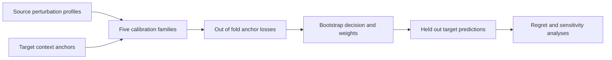

# PerturbCompass

[](https://github.com/nebula123122/PerturbCompass/actions/workflows/tests.yml)

Auditable few-shot calibration and model decisions for cross-context perturbation response transfer.

PerturbCompass uses measured source-context perturbation profiles and a small target-context anchor set to choose or average five transparent calibration families. Anchor Probability Model Averaging (APMA) uses out-of-fold losses and bootstrap best-family frequencies. The evaluation target is regret relative to the best fixed candidate family, alongside replicate consistency, source-defined functional extrapolation and anchor-budget sensitivity.

[中文说明](README.zh-CN.md) · [Research history (HTML; download to view)](docs/research_history.html) · [中文论文与文件导航](docs/project_overview_zh.html) · [Reproduction guide](docs/reproducibility.md) · [Methods](manuscript/methods.md) · [Results](manuscript/results.md)

**Repository status:** research code and locked result tables, available at [nebula123122/PerturbCompass](https://github.com/nebula123122/PerturbCompass). Publication metadata and a code license have not been selected. No paper acceptance or broad cross-study generalization claim is implied.

**Quick start**

```bash
git clone https://github.com/nebula123122/PerturbCompass.git
cd PerturbCompass
conda env create -f environment.yml
conda activate perturbcompass
python -m pip install --no-deps -e .
python -m pytest -q
python -m perturbcompass results
python -m perturbcompass verify
```

The tests and result-table verification do not require the large raw inputs. GitHub Actions runs these checks on Linux and Windows without downloading experimental raw data. `environment.yml` records the original analysis environment; `pyproject.toml` defines package installation and test discovery.

**Paper analyses**

| Analysis | Scientific role |
| --- | --- |
| `k562_cross_study` | Supporting cross-study baseline comparison, including the failed primary gate |
| `k562_screen_validation` | Large-scale within-study residual-program development validation |
| `feng_external_validation` | External held-out-target validation on the Feng iPSC screen |
| `feng_robustness` | Explicitly post hoc robustness and heterogeneity analysis |
| `nadig_selector_validation` | First prospective selector test, with a failed joint gate |
| `cd4t_confirmation` | Three-state primary human CD4 T confirmation after blinded metadata adaptations |
| `replicate_consistency` | Guide and donor-pair consistency of residual versus low-rank gains |
| `source_ood` | Source-defined functional-cluster holdout sensitivity |
| `fallback_sensitivity` | Post hoc exclusion of program-assignment fallback targets |
| `anchor_budget` | Nested 32/64/128/256-anchor sensitivity on the same held-out targets |

List analyses with `python -m perturbcompass analyses`. Reproduce one with `python -m perturbcompass run cd4t_confirmation`. Reproduction writes to `results/reproduced/`; locked reference tables are kept separately in `results/reference/`.

**Development and integrity**

Use an editable installation from this checkout. After reviewed code/configuration changes, run `python scripts/refresh_integrity_manifest.py --reason "Describe the change"`, then rerun tests and verification before committing. The script records a post-result maintenance revision; it does not rewrite historical evidence. Repository operation details are in [the server/Git guide](docs/repository_operations.md).

**Layout**

```text
configs/                 Analysis protocols with descriptive names
src/perturbcompass/       Shared methods, evaluation, data readers and analysis entry points
tests/                   Retained scientific tests and repository integrity checks
data/manifest.json       Raw-input sizes, checksums and download provenance
data/processed/          Fixed eligibility lists, partitions and source-only designs
data/raw/                Local raw inputs; excluded from Git and release archives
results/reference/       Byte-preserved result tables and summaries
results/reproduced/      New execution outputs; excluded from Git
manuscript/              Current methods, results and unresolved submission items
docs/provenance/         Original frozen records, amendments and reorganization mappings
docs/research_history.html  Searchable exploration record, including negative results
scripts/                 Data download and release packaging helpers
```



**Evidence boundaries**

The three CD4 T conditions and donor subsets come from one external study. Target bootstrap intervals describe within-study perturbation stability. Replicate consistency supports a reproducible component but does not identify pure biological truth separately from assay noise. Thirty-two anchors is the smallest tested budget that passed the declared rules; lower budgets were not tested. The methods target summary response profiles for perturbations already measured in the source context.

Historical frozen documents retain their original identifiers inside the text so their hashes remain valid. Current file and folder names use dataset and scientific purpose. Reorganization is dated after results and is not a new preregistration. See [provenance](docs/provenance/README.md) and [release status](docs/release_status.md).

**References and assistance**

Study-specific bibliographic details remain in the original protocols. Data schema: [author documentation](https://github.com/emdann/GWT_perturbseq_analysis_2025/blob/master/metadata/data_sharing_readme.md).

Research-record curation used the scientific-writing and markdown-mermaid-writing procedures from Scientific Agent Skills: Kassis T, Agarwal V, He Y, Patel D, Brueckner AM. *Scientific Agent Skills: A Library of Procedural Knowledge for Research Agents*. 2026. [doi:10.48550/arXiv.2609.00065](https://doi.org/10.48550/arXiv.2609.00065). This is procedural assistance, not independent scientific validation.
